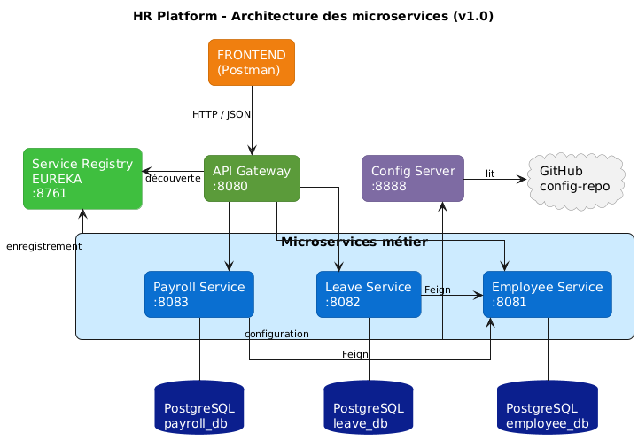
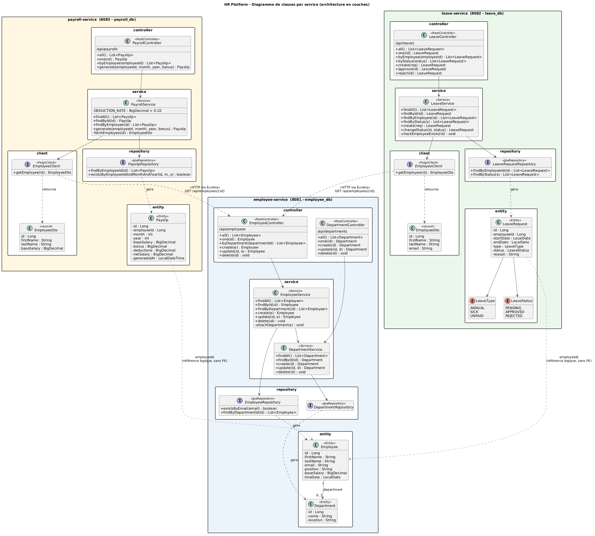

# HR Platform : Gestion des ressources humaines en microservices

Application de gestion des ressources humaines construite avec une **architecture microservices** (Spring Boot et Spring Cloud). Elle couvre trois domaines métier : les **employés**, les **congés** et la **paie**.

Chaque service est indépendant et possède sa propre base de données PostgreSQL. Les services Congés et Paie ne stockent que l'identifiant de l'employé et interrogent le service Employés par **OpenFeign** quand ils ont besoin de ses données.

## Architecture



| Composant | Port | Rôle |
|---|---|---|
| `discovery-server` (Eureka) | 8761 | Annuaire des services : chaque service s'y enregistre |
| `config-server` | 8888 | Configuration centralisée, lue depuis un dépôt Git |
| `api-gateway` | 8080 | Point d'entrée unique, routage vers les services |
| `employee-service` | 8081 | Employés et départements (`employee_db`) |
| `leave-service` | 8082 | Demandes de congé (`leave_db`) |
| `payroll-service` | 8083 | Fiches de paie (`payroll_db`) |

### Fonctionnement

1. Le client (Postman ou un frontend) envoie ses requêtes au **gateway** (port 8080).
2. Le gateway localise le service demandé grâce à **Eureka** et lui transmet la requête.
3. Au démarrage, chaque service récupère sa configuration (port, base de données) auprès du **Config Server**, qui la lit dans le dépôt Git `config-repo`.
4. Pour créer une demande de congé, le **Leave Service** vérifie que l'employé existe en appelant l'**Employee Service** (Feign).
5. Pour générer une fiche de paie, le **Payroll Service** lit le salaire de base de l'employé auprès de l'**Employee Service** (Feign).

## Diagramme de classes



Chaque service suit la même organisation en couches :

```
controller  →  service  →  repository  →  entity
                  │
                  └──→  client (Feign)  →  autre microservice
```

| Couche | Rôle |
|---|---|
| `controller` | Reçoit les requêtes HTTP et appelle le service |
| `service` | Logique métier (règles, calculs, vérifications) |
| `repository` | Accès à la base de données (Spring Data JPA) |
| `entity` | Modèle de données |
| `client` | Appels vers les autres microservices (Feign et DTO) |

## Services

### Employee Service

Entités : `Employee` et `Department` (un employé appartient à un département).

| Méthode | Endpoint | Description |
|---|---|---|
| GET | `/api/employees` | Liste des employés |
| GET | `/api/employees/{id}` | Détail d'un employé |
| GET | `/api/employees/department/{departmentId}` | Employés d'un département |
| POST | `/api/employees` | Créer un employé |
| PUT | `/api/employees/{id}` | Modifier un employé |
| DELETE | `/api/employees/{id}` | Supprimer un employé |
| GET, POST | `/api/departments` | Lister, créer des départements |
| GET, PUT, DELETE | `/api/departments/{id}` | Consulter, modifier, supprimer un département |

Règle : l'email d'un employé doit être unique (erreur 409 sinon).

### Leave Service

Entité : `LeaveRequest` (type : `ANNUAL`, `SICK`, `UNPAID` ; statut : `PENDING`, `APPROVED`, `REJECTED`).

| Méthode | Endpoint | Description |
|---|---|---|
| GET | `/api/leaves` | Liste des demandes |
| GET | `/api/leaves/{id}` | Détail d'une demande |
| GET | `/api/leaves/employee/{employeeId}` | Demandes d'un employé |
| GET | `/api/leaves/status/{status}` | Demandes par statut |
| POST | `/api/leaves` | Créer une demande (statut `PENDING`) |
| PUT | `/api/leaves/{id}/approve` | Approuver |
| PUT | `/api/leaves/{id}/reject` | Refuser |

Règles :
- l'employé doit exister (vérifié via Feign), sinon erreur 404 ;
- la date de fin doit être postérieure ou égale à la date de début (erreur 400 sinon) ;
- seule une demande `PENDING` peut être approuvée ou refusée (erreur 409 sinon).

### Payroll Service

Entité : `Payslip` (fiche de paie mensuelle).

| Méthode | Endpoint | Description |
|---|---|---|
| GET | `/api/payrolls` | Liste des fiches |
| GET | `/api/payrolls/{id}` | Détail d'une fiche |
| GET | `/api/payrolls/employee/{employeeId}` | Fiches d'un employé |
| POST | `/api/payrolls/generate?employeeId=&month=&year=&bonus=` | Générer une fiche |

Règles de calcul :
- brut = salaire de base (lu dans l'Employee Service) + prime ;
- déductions = 10 % du brut ;
- net = brut − déductions.

Contraintes : le mois est compris entre 1 et 12 (erreur 400 sinon), et une seule fiche est possible par employé, mois et année (erreur 409 sinon).

## Technologies

- Java 17 ou supérieur
- Spring Boot, Spring Data JPA, Validation
- Spring Cloud : Netflix Eureka, Config Server, Gateway, OpenFeign
- PostgreSQL
- Lombok
- Maven (projet multi-modules)

## Structure du projet

```
hr-project/
├── pom.xml                 (POM parent)
├── discovery-server/
├── config-server/
├── api-gateway/
├── employee-service/
├── leave-service/
├── payroll-service/
├── architecture.png
└── Classe.png
```

## Dépôts Git

Le projet utilise deux dépôts :

| Dépôt | Contenu |
|---|---|
| **hr-project** (ce dépôt) | Le code des 6 modules et les diagrammes |
| **config-repo** | Les fichiers de configuration lus par le Config Server |

Structure du dépôt `config-repo` (les noms de fichiers doivent correspondre au `spring.application.name` de chaque service) :

```
config-repo/
├── application.properties          (configuration partagée : Eureka)
├── employee-service.properties     (port 8081, employee_db)
├── leave-service.properties        (port 8082, leave_db)
└── payroll-service.properties      (port 8083, payroll_db)
```

Cloner les deux dépôts :

```bash
git clone https://github.com/<utilisateur>/hr-project.git
git clone https://github.com/<utilisateur>/config-repo.git
```

## Installation et lancement

### Prérequis

- JDK 17 ou supérieur
- Maven
- PostgreSQL installé en local
- Postman (pour les tests)

### 1. Créer les bases de données

```sql
CREATE DATABASE employee_db;
CREATE DATABASE leave_db;
CREATE DATABASE payroll_db;
```

Les tables sont créées automatiquement par Hibernate au premier démarrage.

### 2. Configurer le Config Server

Dans `config-server/src/main/resources/application.properties`, renseigner l'URL du dépôt `config-repo` :

```properties
spring.cloud.config.server.git.uri=https://github.com/<utilisateur>/config-repo
spring.cloud.config.server.git.default-label=main
```

Adapter dans `config-repo` l'utilisateur et le mot de passe PostgreSQL de chaque fichier de service.

### 3. Démarrer les modules, dans cet ordre

1. PostgreSQL
2. `discovery-server`, puis vérifier http://localhost:8761
3. `config-server`, puis vérifier http://localhost:8888/employee-service/default
4. `employee-service`, `leave-service`, `payroll-service`
5. `api-gateway`

Attendre environ 30 secondes : les services doivent apparaître en **UP** dans Eureka.

## Utilisation de l'API

Toutes les requêtes passent par le gateway (`http://localhost:8080`). Les routes sont générées automatiquement à partir d'Eureka : le nom du service précède le chemin.

| Service | URL via le gateway |
|---|---|
| Employés | `http://localhost:8080/employee-service/api/employees` |
| Départements | `http://localhost:8080/employee-service/api/departments` |
| Congés | `http://localhost:8080/leave-service/api/leaves` |
| Paie | `http://localhost:8080/payroll-service/api/payrolls` |

### Exemple de scénario (Postman)

Pour les requêtes POST et PUT : **Body → raw → JSON**.

**1. Créer un département**

`POST /employee-service/api/departments`
```json
{ "name": "IT", "location": "Casablanca" }
```

**2. Créer un employé**

`POST /employee-service/api/employees`
```json
{
  "firstName": "Sara",
  "lastName": "Alaoui",
  "email": "sara.alaoui@company.com",
  "position": "Développeuse Java",
  "baseSalary": 12000,
  "hireDate": "2024-03-01",
  "department": { "id": 1 }
}
```

**3. Créer une demande de congé** (l'employé est vérifié via Feign)

`POST /leave-service/api/leaves`
```json
{
  "employeeId": 1,
  "startDate": "2026-11-02",
  "endDate": "2026-11-06",
  "type": "ANNUAL",
  "reason": "Vacances"
}
```

**4. Approuver la demande**

`PUT /leave-service/api/leaves/1/approve`

**5. Générer une fiche de paie** (le salaire est lu via Feign)

`POST /payroll-service/api/payrolls/generate?employeeId=1&month=11&year=2026&bonus=500`

Résultat attendu : brut 12 500, déductions 1 250, net 11 250.

### Cas d'erreur à tester

| Requête | Résultat |
|---|---|
| Congé ou paie avec un `employeeId` inexistant | 404 |
| Même fiche de paie générée deux fois | 409 |
| Approuver deux fois la même demande | 409 |
| Email déjà utilisé à la création d'un employé | 409 |
| Date de fin antérieure à la date de début | 400 |
| `month` hors de 1 à 12 | 400 |

## Résolution de problèmes

| Symptôme | Cause probable |
|---|---|
| Un service refuse de démarrer (`Could not locate PropertySource`) | Le Config Server n'est pas lancé, ou le nom du fichier dans `config-repo` ne correspond pas à `spring.application.name` |
| `password authentication failed` | Identifiants PostgreSQL incorrects dans `config-repo` |
| 404 renvoyé par le gateway | Le nom du service est absent de l'URL (`/leave-service/api/leaves`) ou le service n'est pas encore enregistré dans Eureka |
| 503 ou `Load balancer does not contain an instance` | Le service cible n'est pas encore en **UP** dans Eureka : attendre 30 secondes |
| Configuration non prise en compte | Le dernier commit n'a pas été poussé dans `config-repo`, ou le service n'a pas été redémarré |
