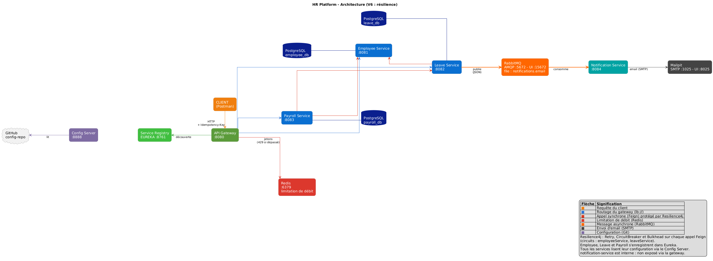
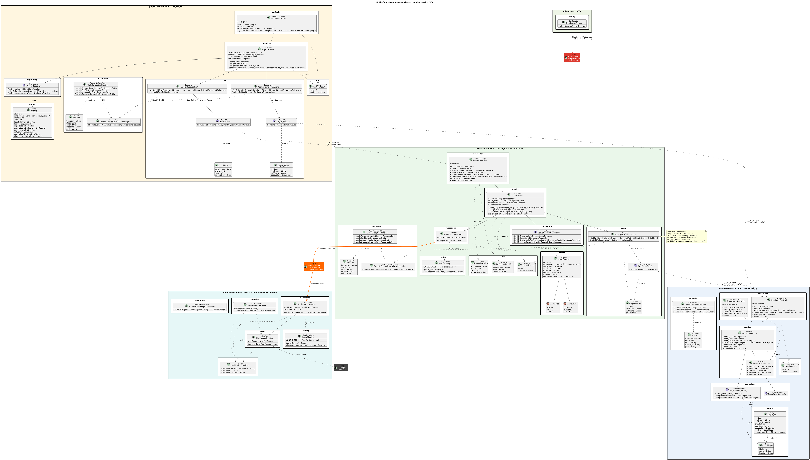
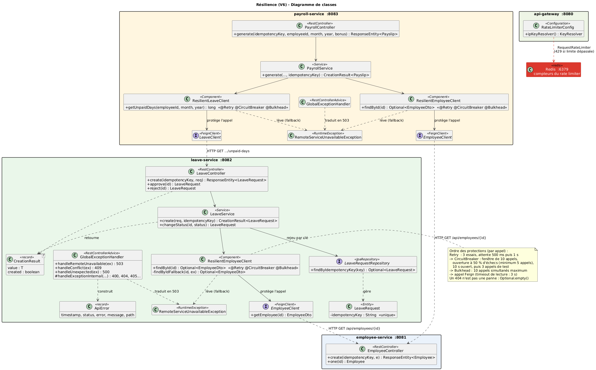

# HR Platform : Gestion des ressources humaines en microservices

Application de gestion des ressources humaines construite avec une **architecture microservices** (Spring Boot et Spring Cloud). Elle couvre trois domaines métier : les **employés**, les **congés** et la **paie**.

Chaque service métier est indépendant et possède sa propre base PostgreSQL (*Database per Service*). L'application met en œuvre :

- une **communication synchrone** (OpenFeign) entre services, protégée par **Resilience4j** (Retry, Circuit Breaker, Bulkhead) ;
- une **communication asynchrone** (RabbitMQ) : un email est envoyé automatiquement à l'employé quand une demande de congé est créée, approuvée ou refusée ;
- une **limitation de débit** (rate limiting) sur l'API Gateway, avec Redis ;
- une **gestion centralisée des erreurs** : un format d'erreur JSON unique dans tous les services ;
- l'**idempotence des créations** : une requête de création rejouée ne crée pas de doublon.

## Architecture



| Composant | Port | Rôle |
|---|---|---|
| `discovery-server` (Eureka) | 8761 | Annuaire des services |
| `config-server` | 8888 | Configuration centralisée, lue depuis le dépôt Git `config-repo` |
| `api-gateway` | 8080 | Point d'entrée unique, routage dynamique, limitation de débit |
| `employee-service` | 8081 | Employés et départements (`employee_db`) |
| `leave-service` | 8082 | Demandes de congé (`leave_db`), **producteur** de messages |
| `payroll-service` | 8083 | Fiches de paie (`payroll_db`) |
| `notification-service` | 8084 | **Consommateur** de messages, envoi des emails (service interne) |
| RabbitMQ | 5672 (AMQP), 15672 (administration) | Broker de messages, file `notifications.email` |
| Mailpit | 1025 (SMTP), 8025 (interface web) | Serveur SMTP de test qui capture les emails |
| Redis | 6379 | Compteurs du rate limiter de la Gateway |

### Communications entre services

| Type | De | Vers | Objet | Protection |
|---|---|---|---|---|
| Synchrone (Feign) | Leave | Employee | Vérifier l'employé, lire son email | Retry, Circuit Breaker, Bulkhead (`employeeService`) |
| Synchrone (Feign) | Payroll | Employee | Lire le salaire de base | Retry, Circuit Breaker, Bulkhead (`employeeService`) |
| Synchrone (Feign) | Payroll | Leave | Lire les jours de congé sans solde du mois | Retry, Circuit Breaker, Bulkhead (`leaveService`) |
| Asynchrone (RabbitMQ) | Leave | Notification | Demande d'envoi d'email (file `notifications.email`) | Reprises du consommateur |
| SMTP | Notification | Mailpit | Envoi de l'email à l'employé | |

## Résilience (Resilience4j)

### Principe

Chaque appel Feign passe par une classe `ResilientEmployeeClient` (et `ResilientLeaveClient` côté Payroll), qui applique les protections dans cet ordre :

```
Retry ( CircuitBreaker ( Bulkhead ( appel Feign ) ) )
```

| Mécanisme | Rôle | Paramètres |
|---|---|---|
| **Timeout** (Feign) | Un appel trop long est un échec | connexion 2 s, lecture 3 s |
| **Retry** | Réessaie les appels en échec | 3 tentatives, attente de 500 ms puis 1 s (exponentielle, facteur 2) |
| **Circuit Breaker** | Refuse les appels vers un service en panne, pour rester réactif | fenêtre de 10 appels, ouverture à 50 % d'échecs (minimum 5 appels), appels de plus de 2 s considérés comme lents (seuil 80 %), 10 s ouvert, puis 3 appels de test (`HALF_OPEN`) |
| **Bulkhead** | Limite les appels simultanés vers un service | 10 appels simultanés, sans attente |
| **Fallback** | Réponse claire quand tout a échoué | erreur **503** `Service unavailable: <service>` |

Règles de conception :

- **Un 404 n'est pas une panne.** Un employé inexistant renvoie `Optional.empty()` : il n'est ni réessayé, ni compté comme un échec par le circuit.
- **Un circuit par service distant** : `employeeService` et `leaveService`. La panne de l'un n'ouvre pas le circuit de l'autre.
- **Pas de retry sur les créations** : seuls les appels de lecture (GET) sont réessayés. Les créations sont protégées par l'idempotence.
- **Pas de transaction ouverte pendant un appel distant** : les appels Feign se font avant la transaction (`TransactionTemplate`), qui reste courte.
- **Pas de valeur par défaut inventée** : si Leave est indisponible, la fiche de paie n'est pas générée plutôt que calculée sans les congés sans solde.

### Cycle de vie du circuit

```
CLOSED ──(≥ 50 % d'échecs)──► OPEN ──(10 s)──► HALF_OPEN ──(3 appels réussis)──► CLOSED
                               │                  │
                               │                  └──(échec)──► OPEN
                               └─ appels refusés immédiatement (aucune tentative)
```

### Observation (Actuator)

Sur `leave-service` (8082) et `payroll-service` (8083) :

| Endpoint | Contenu |
|---|---|
| `/actuator/circuitbreakers` | état de chaque circuit (`CLOSED`, `OPEN`, `HALF_OPEN`), compteurs d'appels, d'échecs et d'appels refusés |
| `/actuator/circuitbreakerevents` | historique : `SUCCESS`, `ERROR`, `NOT_PERMITTED`, transitions d'état |
| `/actuator/retryevents` | historique des tentatives |
| `/actuator/bulkheads` | état du bulkhead |
| `/actuator/health` | santé, dont les circuits |

## Limitation de débit (API Gateway)

Un filtre `RequestRateLimiter` s'applique à **toutes** les routes de la Gateway. Il utilise Redis (algorithme du seau de jetons) et identifie le client par son **adresse IP** (bean `ipKeyResolver`).

| Paramètre | Valeur de démonstration | Signification |
|---|---|---|
| `replenishRate` | 2 | 2 requêtes par seconde en régime stable |
| `burstCapacity` | 5 | pic de 5 requêtes d'un coup toléré |
| `requestedTokens` | 1 | une requête coûte un jeton |

Au-delà de la limite, la Gateway répond **429 Too Many Requests**, avec les en-têtes `X-RateLimit-Remaining`, `X-RateLimit-Burst-Capacity`, `X-RateLimit-Replenish-Rate` et `X-RateLimit-Requested-Tokens`. Si Redis est arrêté, le limiteur laisse passer les requêtes.

## Gestion centralisée des erreurs

Chaque service métier possède une classe `GlobalExceptionHandler` (`@RestControllerAdvice`) et un record `ApiError`. Toutes les erreurs ont le même format :

```json
{
  "timestamp": "2026-11-05T10:15:30.123Z",
  "status": 404,
  "error": "Not Found",
  "message": "Employee not found: 5555",
  "path": "/api/leaves"
}
```

| Cas | Statut |
|---|---|
| Ressource introuvable (employé, demande, fiche), route inconnue | **404** |
| Corps JSON illisible, valeur invalide (enum, date), paramètre invalide, en-tête `Idempotency-Key` manquant | **400** |
| Doublon (email, fiche de paie, demande déjà traitée, contrainte d'unicité) | **409** |
| Service distant indisponible (retry épuisé, circuit ouvert, bulkhead plein) | **503** |
| Méthode HTTP non supportée | **405** |
| Erreur inattendue (jamais de trace de pile envoyée au client) | **500** |

`notification-service` conserve son propre gestionnaire (`NotificationExceptionHandler`) pour les erreurs SMTP.

## Idempotence des créations

Les créations exigent un en-tête `Idempotency-Key` (une valeur unique par opération). La clé est stockée sur la ressource, dans une colonne `idempotencyKey` unique.

| Cas | Comportement |
|---|---|
| Première requête avec la clé | création, **201**, en-tête de réponse `Idempotent-Replayed: false` |
| Même clé rejouée | **aucune création**, **200** avec la ressource d'origine, `Idempotent-Replayed: true`, aucun nouvel email |
| En-tête absent | **400** |
| Deux requêtes simultanées avec la même clé | la contrainte d'unicité en base en laisse passer une seule, l'autre reçoit **409** |

Opérations concernées : `POST /api/employees`, `POST /api/leaves`, `POST /api/payrolls/generate`.

Précisions :

- Un rejeu renvoie la ressource d'origine **sans appeler d'autre service** : il fonctionne même si l'Employee Service est arrêté.
- L'idempotence protège contre les rejeux, pas contre les doublons métier : une autre clé avec le même email (employé) ou les mêmes employé, mois et année (paie) reste refusée en **409**.
- Le contenu d'une requête rejouée n'est pas comparé à l'original.

## Communication asynchrone

### Principe

```
leave-service ──► RabbitMQ ──► notification-service ──SMTP──► Mailpit
(producteur)      file             (consommateur)             (boîte de test)
                  notifications.email
```

1. Une opération réussit dans le Leave Service : demande créée, approuvée ou refusée.
2. Le service prépare une demande d'email (destinataire, objet, contenu) et la publie dans la file `notifications.email` **seulement après le commit de la transaction** (`TransactionSynchronization.afterCommit()`). Si la transaction est annulée, rien n'est publié.
3. La réponse HTTP est renvoyée immédiatement : le Leave Service n'attend pas l'email.
4. Le Notification Service lit la file (`@RabbitListener`), valide le message et envoie l'email au serveur SMTP.

| Élément | Valeur |
|---|---|
| File | `notifications.email` (durable, déclarée par le producteur et par le consommateur) |
| Exchange | exchange par défaut : la clé de routage `notifications.email` dirige le message vers la file du même nom |
| Format | JSON (`JacksonJsonMessageConverter`, Spring AMQP 4.x) |
| Identifiants (démo locale) | `tp` / `tp123` |

Format du message :

```json
{
  "destinataire": "sara.alaoui@company.com",
  "objet": "Demande de congé n° 12 enregistrée",
  "contenu": "Bonjour Sara, votre demande de congé n° 12 (ANNUAL) du 2026-11-02 au 2026-11-06 a été enregistrée. Statut : PENDING."
}
```

Emails envoyés : « Demande de congé n° X enregistrée », « approuvée » ou « refusée ».

### Gestion des erreurs de la messagerie

| Situation | Comportement |
|---|---|
| Consommateur arrêté | Les messages restent dans la file et sont traités au redémarrage |
| Échec du traitement (SMTP arrêté, message invalide) | 3 tentatives au maximum (première comprise), espacées de 2 s, puis rejet **sans remise en file**. Aucune file d'échecs (DLQ) : le message est supprimé et l'erreur reste dans les logs |
| Validation métier refusée (employé inconnu, dates invalides...) | Aucun message publié, donc aucun email |
| RabbitMQ indisponible | La demande reste enregistrée, l'erreur de publication est journalisée, la réponse reste **201**, aucun email n'est envoyé |
| Approbation ou refus alors que l'Employee Service est indisponible | La décision est enregistrée, la notification est ignorée (journalisée) |

La publication n'utilise pas de confirmations (*publisher confirms*) : le retour de la méthode d'envoi ne prouve pas que le broker a stocké le message.

## Diagrammes de classes

**Vue complète** (4 services, gateway et éléments externes). L'image est grande : ouvre-la en grand, ou utilise la version vectorielle `classeV6.svg`.



**Résilience** : clients protégés, fallback, gestion des erreurs, idempotence, rate limiter.



**Communication asynchrone** : producteur, file RabbitMQ, consommateur, SMTP.


Chaque service suit la même organisation en couches :

```
controller  →  service  →  repository  →  entity
                  │
                  ├──→  client (Feign protégé par Resilience4j)  →  autre microservice
                  └──→  messaging (publisher)  →  RabbitMQ
```

| Couche | Rôle |
|---|---|
| `controller` | Reçoit les requêtes HTTP et appelle le service |
| `service` | Logique métier (règles, calculs, vérifications, idempotence) |
| `repository` | Accès à la base de données (Spring Data JPA) |
| `entity` | Modèle de données |
| `client` | Appels vers les autres microservices : interface Feign et classe `Resilient...Client` |
| `messaging` | Publication (Leave) ou consommation (Notification) des messages RabbitMQ |
| `dto` | Objets de transfert (`CreationResult`, messages, réponses de services distants) |
| `config` | Configuration RabbitMQ (file, convertisseur JSON) ou rate limiter (Gateway) |
| `exception` | Gestion centralisée des erreurs (`GlobalExceptionHandler`, `ApiError`) |

Les références entre services se font par identifiant (`employeeId` dans `LeaveRequest` et `Payslip`), sans clé étrangère entre bases.

## Services

Les créations exigent l'en-tête `Idempotency-Key`.

### Employee Service

| Méthode | Endpoint | Description |
|---|---|---|
| GET | `/api/employees` | Liste des employés |
| GET | `/api/employees/{id}` | Détail d'un employé |
| GET | `/api/employees/department/{departmentId}` | Employés d'un département |
| POST | `/api/employees` | Créer un employé (**`Idempotency-Key`** obligatoire) |
| PUT | `/api/employees/{id}` | Modifier un employé |
| DELETE | `/api/employees/{id}` | Supprimer un employé |
| GET, POST | `/api/departments` | Lister, créer des départements |
| GET, PUT, DELETE | `/api/departments/{id}` | Consulter, modifier, supprimer un département |

### Leave Service

Entité `LeaveRequest` (type : `ANNUAL`, `SICK`, `UNPAID` ; statut : `PENDING`, `APPROVED`, `REJECTED`).

| Méthode | Endpoint | Description |
|---|---|---|
| GET | `/api/leaves` | Liste des demandes |
| GET | `/api/leaves/{id}` | Détail d'une demande |
| GET | `/api/leaves/employee/{employeeId}` | Demandes d'un employé |
| GET | `/api/leaves/status/{status}` | Demandes par statut |
| GET | `/api/leaves/employee/{employeeId}/unpaid-days?month=&year=` | Jours de congé sans solde approuvés dans un mois |
| POST | `/api/leaves` | Créer une demande (statut `PENDING`), déclenche l'email (**`Idempotency-Key`** obligatoire) |
| PUT | `/api/leaves/{id}/approve` | Approuver, déclenche l'email |
| PUT | `/api/leaves/{id}/reject` | Refuser, déclenche l'email |

Règles : l'employé doit exister (404) ; la date de fin doit être postérieure ou égale à la date de début (400) ; seule une demande `PENDING` peut être traitée (409).

### Payroll Service

| Méthode | Endpoint | Description |
|---|---|---|
| GET | `/api/payrolls` | Liste des fiches |
| GET | `/api/payrolls/{id}` | Détail d'une fiche |
| GET | `/api/payrolls/employee/{employeeId}` | Fiches d'un employé |
| POST | `/api/payrolls/generate?employeeId=&month=&year=&bonus=` | Générer une fiche (**`Idempotency-Key`** obligatoire) |

Calcul :
- retenue sans solde = salaire de base × jours sans solde du mois ÷ nombre de jours du mois ;
- brut = salaire de base − retenue sans solde + prime ;
- déductions = 10 % du brut ;
- net = brut − déductions.

Contraintes : mois entre 1 et 12 (400) ; une seule fiche par employé, mois et année (409).

### Notification Service

Service **interne**, non exposé via la Gateway.

| Élément | Rôle |
|---|---|
| `NotificationConsumer` | Écoute la file `notifications.email`, valide le message, appelle le service d'envoi |
| `NotificationService` | Construit l'email et l'envoie au serveur SMTP |
| `NotificationController` | `POST /notifications/email` : endpoint de **test manuel** (port 8084 en direct) |
| `NotificationExceptionHandler` | Renvoie 503 si le serveur SMTP est injoignable lors d'un appel HTTP de test |

## Technologies

- Java 17 ou supérieur, Maven (multi-modules)
- Spring Boot, Spring Data JPA, Actuator
- Spring Cloud : Eureka, Config Server, Gateway, OpenFeign
- **Resilience4j** (`resilience4j-spring-boot4` 2.4.0, avec `spring-boot-starter-aspectj`)
- Spring AMQP (RabbitMQ), Spring Mail
- Redis (`spring-boot-starter-data-redis-reactive`, Gateway)
- PostgreSQL
- Docker (RabbitMQ, Mailpit, Redis)
- Lombok

## Structure du projet

```
hr-project/
├── pom.xml                       (POM parent)
├── docker-compose.yml            (alternative aux commandes docker run)
├── discovery-server/
├── config-server/
├── api-gateway/
├── employee-service/
├── leave-service/
├── payroll-service/
├── notification-service/
├── architectureV6.png / architectureV6.puml
├── classeV6.png / classeV6.svg / classeV6.puml
├── classeV6-resilience.png / classeV6-resilience.puml
└── classeV5-asynchrone.png / classeV5-asynchrone.puml
```

## Dépôts Git

| Dépôt | Contenu |
|---|---|
| **hr-project** (ce dépôt) | Le code des 7 modules et les diagrammes |
| **config-repo** | Les fichiers de configuration lus par le Config Server |

Structure du dépôt `config-repo` (chaque nom de fichier correspond au `spring.application.name`) :

```
config-repo/
├── application.properties            (partagé : Eureka, connexion RabbitMQ)
├── employee-service.properties
├── leave-service.properties          (+ Resilience4j : employeeService)
├── payroll-service.properties        (+ Resilience4j : employeeService, leaveService)
└── notification-service.properties   (port 8084, SMTP Mailpit, reprises du consommateur)
```

```bash
git clone https://github.com/<utilisateur>/hr-project.git
git clone https://github.com/<utilisateur>/config-repo.git
```

## Installation et démarrage

### Prérequis

- JDK 17 ou supérieur, Maven
- PostgreSQL installé en local
- Docker Desktop
- Postman

### 1. Bases de données PostgreSQL

```sql
CREATE DATABASE employee_db;
CREATE DATABASE leave_db;
CREATE DATABASE payroll_db;
```

Les tables et les colonnes `idempotencyKey` sont créées automatiquement par Hibernate au démarrage.

### 2. Mailpit, RabbitMQ et Redis (Docker)

Docker Desktop démarré, dans PowerShell :

```powershell
docker run -d --name mailpit -p 127.0.0.1:1025:1025 -p 127.0.0.1:8025:8025 axllent/mailpit
```

```powershell
docker run -d --name rabbitmq -p 127.0.0.1:5672:5672 -p 127.0.0.1:15672:15672 -e RABBITMQ_DEFAULT_USER=tp -e RABBITMQ_DEFAULT_PASS=tp123 -v tp-rabbitmq-data:/var/lib/rabbitmq rabbitmq:4-management
```

```powershell
docker run -d --name redis -p 127.0.0.1:6379:6379 redis:7
```

Ou, avec le fichier fourni : `docker compose up -d`.

| Interface | URL | Identifiants |
|---|---|---|
| Mailpit | http://localhost:8025 | aucun |
| RabbitMQ | http://localhost:15672 | `tp` / `tp123` |

Commandes utiles : `docker ps`, `docker stop mailpit`, `docker start mailpit`, `docker stop rabbitmq`, `docker start rabbitmq`.

### 3. Dépendances ajoutées pour la V6

| Module | Dépendances |
|---|---|
| `leave-service`, `payroll-service` | `io.github.resilience4j:resilience4j-spring-boot4` (version `${resilience4j.version}` = 2.4.0 dans le POM parent), `spring-boot-starter-aspectj`, `spring-boot-starter-actuator` |
| `api-gateway` | `spring-boot-starter-data-redis-reactive` |

### 4. Configuration (dépôt `config-repo`)

`application.properties` (partagé) :

```properties
eureka.client.service-url.defaultZone=http://localhost:8761/eureka/

spring.rabbitmq.host=localhost
spring.rabbitmq.port=5672
spring.rabbitmq.username=tp
spring.rabbitmq.password=tp123
spring.rabbitmq.connection-timeout=2s
```

`leave-service.properties` (et `payroll-service.properties`, avec en plus l'instance `leaveService`) :

```properties
# Feign : délais
spring.cloud.openfeign.client.config.default.connect-timeout=2000
spring.cloud.openfeign.client.config.default.read-timeout=3000
spring.cloud.loadbalancer.retry.enabled=false

# Circuit breaker
resilience4j.circuitbreaker.configs.default.sliding-window-type=COUNT_BASED
resilience4j.circuitbreaker.configs.default.sliding-window-size=10
resilience4j.circuitbreaker.configs.default.minimum-number-of-calls=5
resilience4j.circuitbreaker.configs.default.failure-rate-threshold=50
resilience4j.circuitbreaker.configs.default.slow-call-duration-threshold=2s
resilience4j.circuitbreaker.configs.default.slow-call-rate-threshold=80
resilience4j.circuitbreaker.configs.default.wait-duration-in-open-state=10s
resilience4j.circuitbreaker.configs.default.permitted-number-of-calls-in-half-open-state=3
resilience4j.circuitbreaker.configs.default.automatic-transition-from-open-to-half-open-enabled=true
resilience4j.circuitbreaker.configs.default.register-health-indicator=true
resilience4j.circuitbreaker.instances.employeeService.base-config=default

# Retry
resilience4j.retry.configs.default.max-attempts=3
resilience4j.retry.configs.default.wait-duration=500ms
resilience4j.retry.configs.default.enable-exponential-backoff=true
resilience4j.retry.configs.default.exponential-backoff-multiplier=2
resilience4j.retry.configs.default.ignore-exceptions[0]=io.github.resilience4j.circuitbreaker.CallNotPermittedException
resilience4j.retry.instances.employeeService.base-config=default

# Bulkhead
resilience4j.bulkhead.configs.default.max-concurrent-calls=10
resilience4j.bulkhead.configs.default.max-wait-duration=0ms
resilience4j.bulkhead.instances.employeeService.base-config=default

# Actuator
management.endpoints.web.exposure.include=health,info,circuitbreakers,circuitbreakerevents,retries,retryevents,bulkheads
management.endpoint.health.show-details=always
management.health.circuitbreakers.enabled=true
```

`notification-service.properties` :

```properties
server.port=8084

spring.mail.host=localhost
spring.mail.port=1025
spring.mail.properties.mail.smtp.auth=false
spring.mail.properties.mail.smtp.starttls.enable=false
spring.mail.properties.mail.smtp.connectiontimeout=5000
spring.mail.properties.mail.smtp.timeout=3000
spring.mail.properties.mail.smtp.writetimeout=5000

spring.rabbitmq.listener.simple.retry.enabled=true
spring.rabbitmq.listener.simple.retry.max-retries=3
spring.rabbitmq.listener.simple.retry.initial-interval=2000ms
spring.rabbitmq.listener.simple.default-requeue-rejected=false
```

`api-gateway/src/main/resources/application.properties` (limitation de débit) :

```properties
spring.data.redis.host=localhost
spring.data.redis.port=6379

spring.cloud.gateway.server.webflux.default-filters[0].name=RequestRateLimiter
spring.cloud.gateway.server.webflux.default-filters[0].args.key-resolver=#{@ipKeyResolver}
spring.cloud.gateway.server.webflux.default-filters[0].args.redis-rate-limiter.replenishRate=2
spring.cloud.gateway.server.webflux.default-filters[0].args.redis-rate-limiter.burstCapacity=5
spring.cloud.gateway.server.webflux.default-filters[0].args.redis-rate-limiter.requestedTokens=1
```

Dans `config-server`, l'URL du dépôt de configuration :

```properties
spring.cloud.config.server.git.uri=https://github.com/<utilisateur>/config-repo
spring.cloud.config.server.git.default-label=main
```

Après toute modification : `git commit`, `git push`, puis redémarrer les services concernés.

### 5. Démarrer les modules, dans cet ordre

1. PostgreSQL, Mailpit, RabbitMQ et Redis
2. `discovery-server`, puis http://localhost:8761
3. `config-server`, puis http://localhost:8888/leave-service/default
4. `notification-service`
5. `employee-service`, `leave-service`, `payroll-service`
6. `api-gateway`

Attendre environ 30 secondes : les services doivent apparaître en **UP** dans Eureka. Vérifier ensuite `http://localhost:8082/actuator/circuitbreakers` : le circuit `employeeService` doit être `CLOSED`.

## Utilisation de l'API

Toutes les requêtes passent par la Gateway (`http://localhost:8080`), le nom du service précédant le chemin :

| Service | URL |
|---|---|
| Employés | `http://localhost:8080/employee-service/api/employees` |
| Départements | `http://localhost:8080/employee-service/api/departments` |
| Congés | `http://localhost:8080/leave-service/api/leaves` |
| Paie | `http://localhost:8080/payroll-service/api/payrolls` |

Dans Postman, pour les créations : en-tête `Idempotency-Key` avec la valeur `{{$guid}}` (nouvelle clé à chaque envoi), ou une valeur fixe pour tester un rejeu.

### Données de départ

`POST /employee-service/api/departments`
```json
{ "name": "IT", "location": "Casablanca" }
```

`POST /employee-service/api/employees` (en-tête `Idempotency-Key: emp-001`)
```json
{
  "firstName": "Sara",
  "lastName": "Alaoui",
  "email": "sara.alaoui@company.com",
  "position": "Développeuse Java",
  "baseSalary": 12000,
  "hireDate": "2024-03-01",
  "department": { "id": 1 }
}
```

### Requête qui déclenche la notification

`POST http://localhost:8080/leave-service/api/leaves` (en-tête `Idempotency-Key: {{$guid}}`)
```json
{
  "employeeId": 1,
  "startDate": "2026-11-02",
  "endDate": "2026-11-06",
  "type": "ANNUAL",
  "reason": "Vacances"
}
```

Réponse **201**, `"status": "PENDING"`, puis un email « Demande de congé n° X enregistrée » dans Mailpit (http://localhost:8025). Le champ `idempotencyKey` du corps est ignoré : seul l'en-tête compte.

## Tests Postman

Pour les POST et PUT : **Body, raw, JSON**. Avant une série de tests, vider Mailpit : `DELETE http://localhost:8025/api/v1/messages`.

### Cas de réussite

| # | Requête | Réponse attendue | Vérification |
|---|---|---|---|
| 1 | `POST /leave-service/api/leaves`, `employeeId: 1`, clé `{{$guid}}` | **201**, `Idempotent-Replayed: false`, `status: PENDING` | Mailpit : email « enregistrée » |
| 2 | `PUT /leave-service/api/leaves/{id}/approve` | **200**, `status: APPROVED` | Mailpit : email « approuvée » |
| 3 | Autre demande, puis `PUT .../{id}/reject` | **200**, `status: REJECTED` | Mailpit : email « refusée » |
| 4 | `POST /payroll-service/api/payrolls/generate?employeeId=1&month=12&year=2026&bonus=500`, clé `{{$guid}}` | **201**, fiche calculée | brut, déductions et net corrects |
| 5 | `POST http://localhost:8084/notifications/email` | **204** | Mailpit : l'email de test |

### Cas d'échec et format d'erreur

| # | Scénario | Réponse attendue (corps au format `ApiError`) |
|---|---|---|
| 6 | Employé inexistant (`employeeId: 5555`) | **404** `Employee not found: 5555`, aucun email |
| 7 | Dates incohérentes (`endDate` avant `startDate`) | **400**, aucun email |
| 8 | `approve` deux fois | **409** à la 2e requête, un seul email |
| 9 | En-tête `Idempotency-Key` absent | **400** `Required header 'Idempotency-Key' is not present` |
| 10 | `GET /leave-service/api/leaves/status/FOO` | **400** `Invalid value for a request parameter: FOO` |
| 11 | Corps JSON invalide | **400** `Malformed or unreadable request body` |
| 12 | `GET /leave-service/api/inconnu` | **404**, même format |

### Idempotence

| # | Requête | Réponse attendue |
|---|---|---|
| 13 | `POST /leave-service/api/leaves`, clé fixe `leave-001` | **201**, `Idempotent-Replayed: false`, un email |
| 14 | Même requête, même clé | **200**, `Idempotent-Replayed: true`, **même `id`**, toujours un seul email |
| 15 | `POST /payroll-service/api/payrolls/generate?...`, clé `pay-001`, puis rejeu | **201** puis **200**, même fiche |
| 16 | Même employé, mois et année, clé `pay-002` | **409** `Payslip already generated` |
| 17 | `POST /employee-service/api/employees`, clé `emp-001`, puis rejeu | **201** puis **200**, même `id` |
| 18 | Même email, nouvelle clé | **409** `Email already used` |

Vérification en base : `SELECT id, idempotency_key FROM leave_requests WHERE idempotency_key = 'leave-001';` renvoie **une seule ligne**.

### Résilience (Leave → Employee)

Utiliser une clé `{{$guid}}` (une clé fixe renverrait un rejeu **200** même avec Employee arrêté). Redémarrer `leave-service` avant le test pour repartir de compteurs à zéro.

| Étape | Action | Résultat attendu |
|---|---|---|
| 1 | Employee démarré, créer une demande | **201** ; `/actuator/circuitbreakers` : `employeeService` `CLOSED` |
| 2 | 10 requêtes avec un employé inexistant | **404** à chaque fois ; circuit toujours `CLOSED`, `failedCalls: 0` |
| 3 | **Arrêter `employee-service`**, une requête | **503** `Service unavailable: employee-service` après **≈ 1,5 s** (3 tentatives) |
| 4 | Une 2e requête | **503** ; le circuit passe à `OPEN` (événement `CLOSED_TO_OPEN`) |
| 5 | Requêtes suivantes | **503 en quelques ms**, aucune tentative dans les logs ; `OPEN`, `notPermittedCalls` augmente |
| 6 | Attendre 10 s | `HALF_OPEN` |
| 7 | Redémarrer Employee, attendre 35 s, puis 3 requêtes | **201** ; retour à `CLOSED` (`OPEN_TO_HALF_OPEN`, `HALF_OPEN_TO_CLOSED`) |

### Résilience (Payroll : deux circuits indépendants)

| Action | Résultat attendu |
|---|---|
| **Arrêter `leave-service`**, puis `POST /payroll-service/api/payrolls/generate?employeeId=1&month=3&year=2027` (clé `{{$guid}}`), 3 fois | **503** `Service unavailable: leave-service` |
| `GET http://localhost:8083/actuator/circuitbreakers` | `leaveService` `OPEN` ; `employeeService` reste `CLOSED` |
| `GET /payroll-service/api/payrolls/employee/1` | aucune fiche de mars 2027 : rien n'est créé pendant la panne |
| Redémarrer Leave, attendre, renvoyer avec une nouvelle clé | **201** |

### Limitation de débit (Gateway)

1. Requête `GET http://localhost:8080/employee-service/api/employees` enregistrée dans une collection.
2. **Run collection** : 20 itérations, délai 0 ms.
3. Résultat attendu : les 5 à 7 premières réponses en **200**, les suivantes en **429**, avec les en-têtes `X-RateLimit-*`.
4. Après quelques secondes, le **200** revient.

### Communication asynchrone

| # | Scénario | Résultat attendu |
|---|---|---|
| 19 | Arrêter `notification-service`, créer 2 demandes | **201** immédiats ; RabbitMQ, file `notifications.email` : **Ready = 2** ; Mailpit : aucun email |
| 20 | Redémarrer `notification-service` | 2 emails reçus ; **Ready** et **Unacked** à **0** |
| 21 | `docker stop mailpit`, créer une demande | **201** ; 3 tentatives dans la console du consommateur, puis rejet |
| 22 | `docker stop rabbitmq`, créer une demande | **201** ; « publication de la notification en échec » dans la console de Leave ; aucun email |

Consulter les messages en attente : `POST http://localhost:15672/api/queues/%2F/notifications.email/get` (Basic Auth `tp` / `tp123`), corps `{ "count": 5, "ackmode": "ack_requeue_true", "encoding": "auto" }`.

Vérifier les emails reçus : `GET http://localhost:8025/api/v1/messages`.

## Résolution de problèmes

| Symptôme | Cause probable |
|---|---|
| `leave-service` ne démarre pas : « required a bean of type RabbitTemplate » | `spring-boot-starter-amqp` manque dans le `pom.xml` de `leave-service` (recharger Maven) |
| Les annotations `@Retry` / `@CircuitBreaker` sont ignorées, `/actuator/circuitbreakers` est vide | `spring-boot-starter-aspectj` manque, ou la méthode annotée est appelée depuis la **même classe** (le proxy est contourné) |
| Le circuit ne s'ouvre jamais | Configuration non poussée sur `config-repo`, ou service non redémarré : vérifier `http://localhost:8888/leave-service/default` |
| Le circuit s'ouvre sur des 404 | L'appel Feign lève une autre exception que `FeignException.NotFound` dans `findById` |
| 503 instantané dès la première requête | Circuit déjà `OPEN` d'un test précédent : attendre 10 s ou redémarrer le service |
| 200 alors que l'Employee Service est arrêté | Rejeu d'une clé `Idempotency-Key` déjà utilisée : utiliser `{{$guid}}` |
| 400 `Required header 'Idempotency-Key'` | L'en-tête est obligatoire sur les créations |
| 429 inattendu | Plus de 5 requêtes en rafale via la Gateway : attendre 2 s, ou appeler le service en direct |
| Aucun 429 en martelant la Gateway | Redis arrêté, ou préfixe `spring.cloud.gateway.server.webflux.default-filters[0]` incorrect |
| `Connection refused` vers `localhost:5672`, `1025` ou `6379` | RabbitMQ, Mailpit ou Redis non démarré (`docker ps`) |
| `ACCESS_REFUSED` à la connexion RabbitMQ | Identifiants différents de `tp` / `tp123` dans `config-repo` |
| Un service refuse de démarrer (`Could not locate PropertySource`) | Config Server non lancé, ou nom de fichier de `config-repo` différent de `spring.application.name` |
| Aucun email malgré un 201 | `notification-service` arrêté, ou message rejeté après les tentatives : consulter sa console |
| 404 renvoyé par la Gateway | Nom du service absent de l'URL, ou service pas encore **UP** dans Eureka |
| Configuration non prise en compte | Dernier commit non poussé dans `config-repo`, ou service non redémarré |