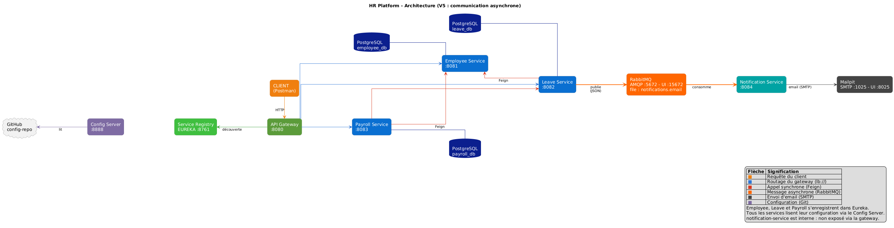
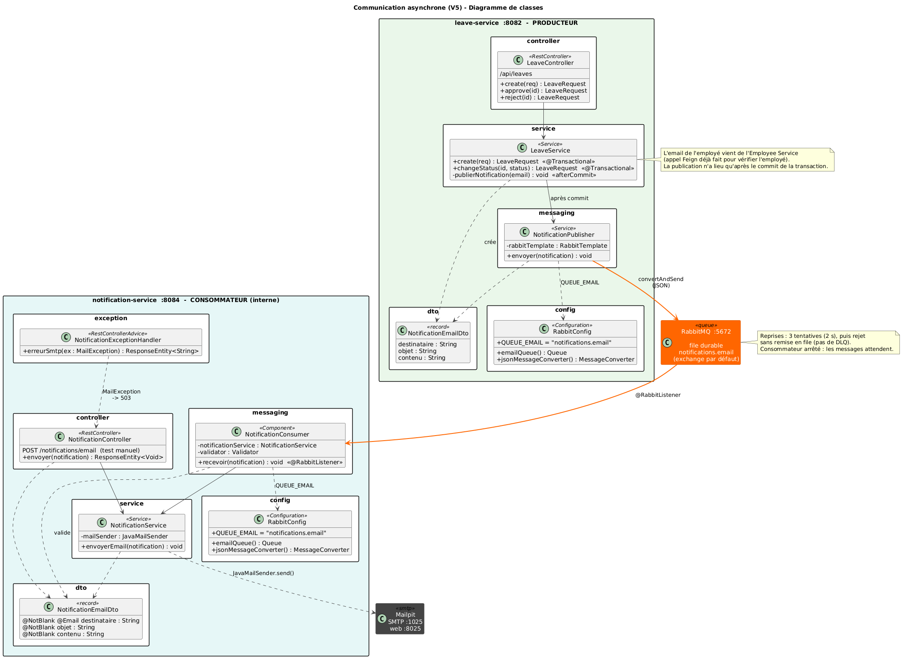

# HR Platform : Gestion des ressources humaines en microservices

Application de gestion des ressources humaines construite avec une **architecture microservices** (Spring Boot et Spring Cloud). Elle couvre trois domaines métier : les **employés**, les **congés** et la **paie**. Un **service de notification** envoie automatiquement un email à l'employé lorsqu'une demande de congé est créée, approuvée ou refusée, de façon **asynchrone** grâce à RabbitMQ.

Chaque service métier est indépendant et possède sa propre base PostgreSQL (*Database per Service*). Les services communiquent de deux façons :

- **synchrone** (OpenFeign) quand une réponse immédiate est nécessaire ;
- **asynchrone** (RabbitMQ) pour les notifications : le service métier publie une demande d'email dans une file et n'attend ni l'envoi, ni le service de notification.

## Architecture



| Composant | Port | Rôle |
|---|---|---|
| `discovery-server` (Eureka) | 8761 | Annuaire des services |
| `config-server` | 8888 | Configuration centralisée, lue depuis le dépôt Git `config-repo` |
| `api-gateway` | 8080 | Point d'entrée unique, routage dynamique vers les services |
| `employee-service` | 8081 | Employés et départements (`employee_db`) |
| `leave-service` | 8082 | Demandes de congé (`leave_db`), **producteur** de messages |
| `payroll-service` | 8083 | Fiches de paie (`payroll_db`) |
| `notification-service` | 8084 | **Consommateur** de messages, envoi des emails (service interne) |
| RabbitMQ | 5672 (AMQP), 15672 (administration) | Broker de messages, file `notifications.email` |
| Mailpit | 1025 (SMTP), 8025 (interface web) | Serveur SMTP de test qui capture les emails |

### Communications entre services

| Type | De | Vers | Objet |
|---|---|---|---|
| Synchrone (Feign) | Leave | Employee | Vérifier que l'employé existe, lire son email |
| Synchrone (Feign) | Payroll | Employee | Lire le salaire de base |
| Synchrone (Feign) | Payroll | Leave | Lire les jours de congé sans solde d'un mois |
| Asynchrone (RabbitMQ) | Leave | Notification | Demande d'envoi d'email (file `notifications.email`) |
| SMTP | Notification | Mailpit | Envoi de l'email à l'employé |

## Communication asynchrone (V5)

### Principe

```
leave-service ──► RabbitMQ ──► notification-service ──SMTP──► Mailpit
(producteur)      file             (consommateur)             (boîte de test)
                  notifications.email
```

1. Une opération réussit dans le Leave Service : demande créée, approuvée ou refusée.
2. Le service prépare une demande d'email (destinataire, objet, contenu) et la publie dans la file `notifications.email` **seulement après le commit de la transaction** (`TransactionSynchronization.afterCommit()`). Si la transaction est annulée, rien n'est publié.
3. La réponse HTTP est renvoyée immédiatement : le Leave Service n'attend pas l'email.
4. Le Notification Service lit la file (`@RabbitListener`), valide le message et envoie l'email au serveur SMTP.

### Éléments RabbitMQ

| Élément | Valeur |
|---|---|
| File | `notifications.email` (durable, déclarée par le producteur et par le consommateur) |
| Exchange | exchange par défaut : la clé de routage `notifications.email` dirige le message vers la file du même nom |
| Format | JSON (`JacksonJsonMessageConverter`, Spring AMQP 4.x) |
| Identifiants (démo locale) | `tp` / `tp123` |

### Format du message

```json
{
  "destinataire": "sara.alaoui@company.com",
  "objet": "Demande de congé n° 12 enregistrée",
  "contenu": "Bonjour Sara, votre demande de congé n° 12 (ANNUAL) du 2026-11-02 au 2026-11-06 a été enregistrée. Statut : PENDING."
}
```

Le format est générique (destinataire, objet, contenu) : le service de notification ne connaît pas la notion de congé, et d'autres services pourront publier dans la même file.

### Emails envoyés

| Opération | Objet de l'email |
|---|---|
| Création d'une demande | « Demande de congé n° X enregistrée » |
| Approbation | « Demande de congé n° X approuvée » |
| Refus | « Demande de congé n° X refusée » |

### Gestion des erreurs

| Situation | Comportement |
|---|---|
| Consommateur arrêté | Les messages restent dans la file et sont traités au redémarrage |
| Échec du traitement (SMTP arrêté, message invalide) | 3 tentatives au maximum (première comprise), espacées de 2 s, puis rejet **sans remise en file**. Aucune file d'échecs (DLQ) n'est configurée : le message est supprimé et l'erreur reste dans les logs |
| Validation métier refusée (employé inconnu, dates invalides, demande déjà traitée) | Aucun message publié, donc aucun email |
| RabbitMQ indisponible | La demande reste enregistrée (transaction déjà validée), l'erreur de publication est journalisée, la réponse reste **201** et aucun email n'est envoyé |
| Notification d'une approbation ou d'un refus alors que l'Employee Service est indisponible | La décision est enregistrée, la notification est ignorée (journalisée) |

La publication n'utilise pas de confirmations (*publisher confirms*) : le retour de la méthode d'envoi ne prouve pas que le broker a stocké le message.

## Diagramme de classes



Chaque service suit la même organisation en couches :

```
controller  →  service  →  repository  →  entity
                  │
                  ├──→  client (Feign)  →  autre microservice
                  └──→  messaging (publisher)  →  RabbitMQ
```

| Couche | Rôle |
|---|---|
| `controller` | Reçoit les requêtes HTTP et appelle le service |
| `service` | Logique métier (règles, calculs, vérifications) |
| `repository` | Accès à la base de données (Spring Data JPA) |
| `entity` | Modèle de données |
| `client` | Appels vers les autres microservices (Feign et DTO) |
| `messaging` | Publication (Leave) ou consommation (Notification) des messages RabbitMQ |
| `dto` | Objets de transfert (messages, réponses de services distants) |
| `config` | Configuration RabbitMQ (file et convertisseur JSON) |
| `exception` | Gestion des erreurs (`@RestControllerAdvice`) |

Les références entre services se font par identifiant (`employeeId` dans `LeaveRequest` et `Payslip`), sans clé étrangère entre bases.

## Services

### Employee Service

Entités : `Employee` et `Department`.

| Méthode | Endpoint | Description |
|---|---|---|
| GET | `/api/employees` | Liste des employés |
| GET | `/api/employees/{id}` | Détail d'un employé |
| GET | `/api/employees/department/{departmentId}` | Employés d'un département |
| POST | `/api/employees` | Créer un employé |
| PUT | `/api/employees/{id}` | Modifier un employé |
| DELETE | `/api/employees/{id}` | Supprimer un employé |
| GET, POST | `/api/departments` | Lister, créer des départements |
| GET, PUT, DELETE | `/api/departments/{id}` | Consulter, modifier, supprimer un département |

### Leave Service

Entité : `LeaveRequest` (type : `ANNUAL`, `SICK`, `UNPAID` ; statut : `PENDING`, `APPROVED`, `REJECTED`).

| Méthode | Endpoint | Description |
|---|---|---|
| GET | `/api/leaves` | Liste des demandes |
| GET | `/api/leaves/{id}` | Détail d'une demande |
| GET | `/api/leaves/employee/{employeeId}` | Demandes d'un employé |
| GET | `/api/leaves/status/{status}` | Demandes par statut |
| GET | `/api/leaves/employee/{employeeId}/unpaid-days?month=&year=` | Jours de congé sans solde approuvés dans un mois |
| POST | `/api/leaves` | Créer une demande (statut `PENDING`) et déclencher l'email |
| PUT | `/api/leaves/{id}/approve` | Approuver et déclencher l'email |
| PUT | `/api/leaves/{id}/reject` | Refuser et déclencher l'email |

Règles : l'employé doit exister (404 sinon) ; la date de fin doit être postérieure ou égale à la date de début (400) ; seule une demande `PENDING` peut être traitée (409).

### Payroll Service

Entité : `Payslip`.

| Méthode | Endpoint | Description |
|---|---|---|
| GET | `/api/payrolls` | Liste des fiches |
| GET | `/api/payrolls/{id}` | Détail d'une fiche |
| GET | `/api/payrolls/employee/{employeeId}` | Fiches d'un employé |
| POST | `/api/payrolls/generate?employeeId=&month=&year=&bonus=` | Générer une fiche |

Calcul :
- retenue sans solde = salaire de base × jours sans solde du mois ÷ nombre de jours du mois ;
- brut = salaire de base − retenue sans solde + prime ;
- déductions = 10 % du brut ;
- net = brut − déductions.

Contraintes : mois entre 1 et 12 (400) ; une seule fiche par employé, mois et année (409).

### Notification Service

Service **interne** : il n'est pas exposé via la gateway.

| Élément | Rôle |
|---|---|
| `NotificationConsumer` | Écoute la file `notifications.email`, valide le message et appelle le service d'envoi |
| `NotificationService` | Construit l'email et l'envoie au serveur SMTP |
| `NotificationController` | `POST /notifications/email` : endpoint de **test manuel** uniquement (port 8084 direct) |
| `NotificationExceptionHandler` | Renvoie 503 si le serveur SMTP est injoignable lors d'un appel HTTP de test |

## Technologies

- Java 17 ou supérieur
- Spring Boot, Spring Data JPA, Validation
- Spring Cloud : Eureka, Config Server, Gateway, OpenFeign
- Spring AMQP (RabbitMQ), Spring Mail
- PostgreSQL
- Docker (RabbitMQ et Mailpit)
- Lombok, Maven (multi-modules)

## Structure du projet

```
hr-project/
├── pom.xml                 (POM parent)
├── docker-compose.yml      (alternative aux commandes docker run)
├── discovery-server/
├── config-server/
├── api-gateway/
├── employee-service/
├── leave-service/
├── payroll-service/
├── notification-service/
├── architectureV5.png / architectureV5.puml
└── classeV5.png / classeV5.puml
```

## Dépôts Git

| Dépôt | Contenu |
|---|---|
| **hr-project** (ce dépôt) | Le code des 7 modules et les diagrammes |
| **config-repo** | Les fichiers de configuration lus par le Config Server |

Structure du dépôt `config-repo` (chaque nom de fichier correspond au `spring.application.name`) :

```
config-repo/
├── application.properties            (partagé : Eureka, connexion RabbitMQ)
├── employee-service.properties
├── leave-service.properties
├── payroll-service.properties
└── notification-service.properties   (port 8084, SMTP Mailpit, reprises du consommateur)
```

```bash
git clone https://github.com/<utilisateur>/hr-project.git
git clone https://github.com/<utilisateur>/config-repo.git
```

## Installation et démarrage

### Prérequis

- JDK 17 ou supérieur, Maven
- PostgreSQL installé en local
- Docker Desktop
- Postman

### 1. Bases de données PostgreSQL

```sql
CREATE DATABASE employee_db;
CREATE DATABASE leave_db;
CREATE DATABASE payroll_db;
```

Les tables sont créées automatiquement par Hibernate au premier démarrage.

### 2. Mailpit et RabbitMQ (Docker)

Docker Desktop démarré, dans PowerShell :

```powershell
docker run -d --name mailpit -p 127.0.0.1:1025:1025 -p 127.0.0.1:8025:8025 axllent/mailpit
```

```powershell
docker run -d --name rabbitmq -p 127.0.0.1:5672:5672 -p 127.0.0.1:15672:15672 -e RABBITMQ_DEFAULT_USER=tp -e RABBITMQ_DEFAULT_PASS=tp123 -v tp-rabbitmq-data:/var/lib/rabbitmq rabbitmq:4-management
```

Ou, avec le fichier fourni : `docker compose up -d`.

| Interface | URL | Identifiants |
|---|---|---|
| Mailpit | http://localhost:8025 | aucun |
| RabbitMQ | http://localhost:15672 | `tp` / `tp123` |

Commandes utiles :

```powershell
docker ps                  # conteneurs en cours
docker stop mailpit        # simuler une panne SMTP
docker start mailpit
docker stop rabbitmq       # simuler une panne du broker
docker start rabbitmq
```

Les adresses `localhost` supposent que les applications Java tournent depuis l'IDE sur la machine hôte. Si elles étaient conteneurisées, il faudrait utiliser les noms d'hôtes du réseau Docker.

### 3. Configuration (dépôt `config-repo`)

`application.properties` (partagé) :

```properties
eureka.client.service-url.defaultZone=http://localhost:8761/eureka/

spring.rabbitmq.host=localhost
spring.rabbitmq.port=5672
spring.rabbitmq.username=tp
spring.rabbitmq.password=tp123
spring.rabbitmq.connection-timeout=2s
```

`notification-service.properties` :

```properties
server.port=8084

spring.mail.host=localhost
spring.mail.port=1025
spring.mail.properties.mail.smtp.auth=false
spring.mail.properties.mail.smtp.starttls.enable=false
spring.mail.properties.mail.smtp.connectiontimeout=5000
spring.mail.properties.mail.smtp.timeout=3000
spring.mail.properties.mail.smtp.writetimeout=5000

spring.rabbitmq.listener.simple.retry.enabled=true
spring.rabbitmq.listener.simple.retry.max-retries=3
spring.rabbitmq.listener.simple.retry.initial-interval=2000ms
spring.rabbitmq.listener.simple.default-requeue-rejected=false
```

Dans `config-server`, l'URL du dépôt de configuration :

```properties
spring.cloud.config.server.git.uri=https://github.com/<utilisateur>/config-repo
spring.cloud.config.server.git.default-label=main
```

Après toute modification : `git commit`, `git push`, puis redémarrer les services concernés.

### 4. Démarrer les modules, dans cet ordre

1. PostgreSQL, Mailpit et RabbitMQ
2. `discovery-server`, puis http://localhost:8761
3. `config-server`, puis http://localhost:8888/notification-service/default
4. `notification-service`
5. `employee-service`, `leave-service`, `payroll-service`
6. `api-gateway`

Attendre environ 30 secondes : les services doivent apparaître en **UP** dans Eureka. Dans RabbitMQ (onglet *Queues and Streams*), la file `notifications.email` doit exister.

## Utilisation de l'API

Toutes les requêtes passent par le gateway (`http://localhost:8080`), le nom du service précédant le chemin :

| Service | URL |
|---|---|
| Employés | `http://localhost:8080/employee-service/api/employees` |
| Départements | `http://localhost:8080/employee-service/api/departments` |
| Congés | `http://localhost:8080/leave-service/api/leaves` |
| Paie | `http://localhost:8080/payroll-service/api/payrolls` |

### Données de départ

`POST /employee-service/api/departments`
```json
{ "name": "IT", "location": "Casablanca" }
```

`POST /employee-service/api/employees`
```json
{
  "firstName": "Sara",
  "lastName": "Alaoui",
  "email": "sara.alaoui@company.com",
  "position": "Développeuse Java",
  "baseSalary": 12000,
  "hireDate": "2024-03-01",
  "department": { "id": 1 }
}
```

### Requête qui déclenche la notification

`POST http://localhost:8080/leave-service/api/leaves`
```json
{
  "employeeId": 1,
  "startDate": "2026-11-02",
  "endDate": "2026-11-06",
  "type": "ANNUAL",
  "reason": "Vacances"
}
```

Réponse **201** avec `"status": "PENDING"`, puis un email « Demande de congé n° X enregistrée » apparaît dans Mailpit (http://localhost:8025) pour `sara.alaoui@company.com`.

## Tests Postman

Pour les POST et PUT : **Body, raw, JSON**. Avant une série de tests, vider Mailpit : `DELETE http://localhost:8025/api/v1/messages`.

### Cas de réussite

| # | Requête | Réponse attendue | Vérification |
|---|---|---|---|
| 1 | `POST /leave-service/api/leaves` avec `employeeId: 1` | **201**, `status: PENDING` | Mailpit : email « enregistrée », destinataire, numéro et dates corrects |
| 2 | `PUT /leave-service/api/leaves/{id}/approve` | **200**, `status: APPROVED` | Mailpit : email « approuvée » |
| 3 | Créer une autre demande puis `PUT .../{id}/reject` | **200**, `status: REJECTED` | Mailpit : email « refusée » |
| 4 | `POST http://localhost:8084/notifications/email` avec `{"destinataire":"a@b.com","objet":"Test","contenu":"Bonjour"}` | **204** | Mailpit : l'email de test (envoi direct, sans RabbitMQ) |

Vérifier les emails reçus : `GET http://localhost:8025/api/v1/messages` (le champ `total` augmente, chaque message contient `Subject` et `To`).

### Cas d'échec

| # | Scénario | Requête | Réponse attendue | Emails |
|---|---|---|---|---|
| 5 | Employé inexistant | `POST /leave-service/api/leaves` avec `employeeId: 5555` | **404** | aucun |
| 6 | Dates incohérentes | même requête, `startDate: 2026-11-10`, `endDate: 2026-11-05` | **400** | aucun |
| 7 | Demande déjà traitée | `PUT .../{id}/approve` deux fois | **409** à la 2e requête | un seul |
| 8 | Employee Service arrêté | `POST /leave-service/api/leaves` | **503** | aucun |
| 9 | Email invalide (test direct) | `POST http://localhost:8084/notifications/email` avec `"destinataire": "pas-un-email"` | **400** | aucun |
| 10 | SMTP arrêté (test direct) | `docker stop mailpit`, puis un envoi valide sur `/notifications/email` | **503** | aucun |

### Traitement différé (consommateur arrêté)

1. Arrêter `notification-service` (RabbitMQ et Mailpit restent démarrés).
2. Créer 2 demandes de congé : réponses **201** immédiates.
3. RabbitMQ, file `notifications.email` : **Ready = 2**, aucun consommateur connecté. Mailpit : aucun nouvel email.
4. Redémarrer `notification-service`.
5. Mailpit reçoit les **2 emails** ; **Ready** et **Unacked** retombent à **0**.

Pour consulter les messages en attente dans Postman :

`POST http://localhost:15672/api/queues/%2F/notifications.email/get` (Authorization : Basic Auth `tp` / `tp123`)
```json
{ "count": 5, "ackmode": "ack_requeue_true", "encoding": "auto" }
```

La réponse contient, pour chaque message, le `payload` (JSON de la demande d'email) et ses `properties`. L'état de la file est donné par `GET http://localhost:15672/api/queues/%2F/notifications.email` (champ `messages_ready`).

### Panne SMTP : reprises puis abandon

1. `docker stop mailpit`.
2. `POST /leave-service/api/leaves` : **201** (la demande est enregistrée).
3. Console de `notification-service` : le traitement du message est repris (3 tentatives au maximum), puis le message est rejeté.
4. `docker start mailpit` : le message rejeté n'est pas récupéré (pas de DLQ).

### Message invalide

Dans RabbitMQ (*Queues, notifications.email, Publish message*), avec la propriété `content_type` = `application/json` et le payload :

```json
{ "destinataire": "pas-un-email", "objet": "", "contenu": "" }
```

Le consommateur rejette le message (violation de validation) après les tentatives. Aucun email n'est envoyé.

### RabbitMQ arrêté

1. `docker stop rabbitmq`.
2. `POST /leave-service/api/leaves` : **201**, la demande est enregistrée.
3. Console de `leave-service` : « Demande enregistrée, mais publication de la notification en échec ». Aucun email.
4. `docker start rabbitmq`.

## Résolution de problèmes

| Symptôme | Cause probable |
|---|---|
| `leave-service` ne démarre pas : « required a bean of type RabbitTemplate » | La dépendance `spring-boot-starter-amqp` manque dans le `pom.xml` de `leave-service` (recharger Maven) |
| Un service refuse de démarrer (`Could not locate PropertySource`) | Config Server non lancé, ou nom de fichier de `config-repo` différent de `spring.application.name` |
| `Connection refused` vers `localhost:5672` | RabbitMQ n'est pas démarré (`docker ps`) |
| `ACCESS_REFUSED` à la connexion RabbitMQ | Identifiants différents de `tp` / `tp123` dans `config-repo`, ou conteneur recréé avec d'autres identifiants et un volume existant |
| `Connection refused` vers `localhost:1025` | Mailpit n'est pas démarré |
| Aucun email malgré un 201 | `notification-service` arrêté, ou message rejeté après les tentatives : consulter la console du service |
| Message en erreur de conversion | Le message n'est pas du JSON valide, ou n'a pas la propriété `content_type=application/json` |
| 404 renvoyé par le gateway | Nom du service absent de l'URL, ou service pas encore **UP** dans Eureka |
| Configuration non prise en compte | Dernier commit non poussé dans `config-repo`, ou service non redémarré |
